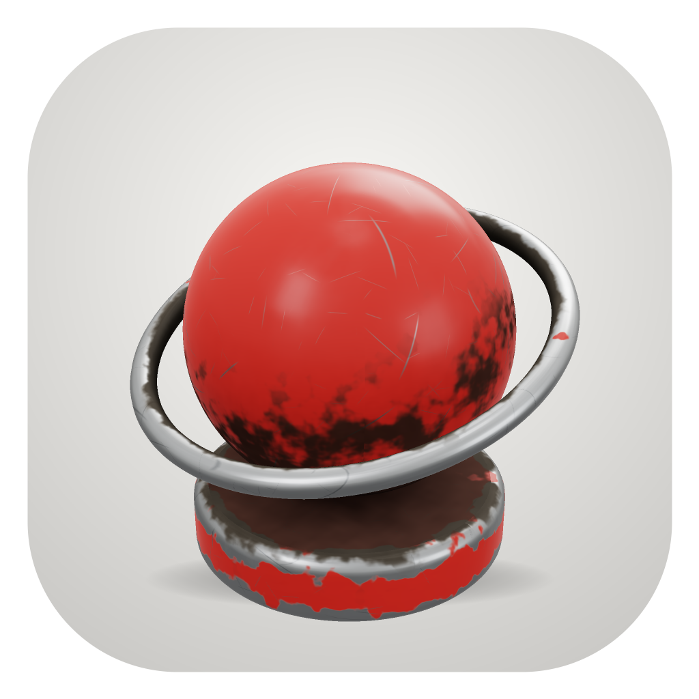

<p align="center">
  
</p>

# Patina

Desktop app for painting physically based materials onto 3D meshes, built so that people and AI agents use the same tools.
An open-source, local-first alternative to Substance 3D Painter, made clean-room from public documentation.

- **Layers**: fill layers (a material over the whole surface), paint layers (brush strokes) and folders, with per-channel blend modes and opacity.
- **Masks**: black/white masks with an effect stack: generators (edge wear, dirt, curvature, ambient occlusion, facing direction, position gradient, noise), painted masks and levels.
- **Smart materials**: painted steel, rusty iron, aged gold, copper patina, military paint, scuffed plastic, glazed ceramic. 19 base materials and 6 smart masks.
- **Painting**: brush with size, hardness, flow, opacity, spacing, spray/grunge alphas, pen pressure, mirror symmetry, camera or 3D-sphere projection. Paint in the 3D view or straight on the UV layout.
- **No seams**: strokes, noises and generators live in the object's 3D space, so UV seams never show. Strokes are stored as data, so a project re-renders at any resolution (export at 4096 from a 1024 session without upscaling).
- **Baking**: curvature and ambient occlusion per texel, from the paint mesh itself.
- **Export**: glTF PBR Metal/Roughness, Unreal Engine (packed ORM, DirectX normal), Unity HDRP, Unity URP, separate maps (16-bit height), and a self-contained `.glb`.
- **For agents**: every action is a typed command with undo. Agents drive the open window live, or work headless with no window at all, through MCP or the CLI. They can look at their work with a CPU renderer that matches the viewport.

Documents are plain JSON (`.patina`), easy to diff, review and generate.

## Requirements

- Node.js 22.12 or newer and npm.
- For the desktop app only: Rust (stable) and the [Tauri 2 prerequisites](https://v2.tauri.app/start/prerequisites/). The bundle config targets Linux (`.deb`, `.AppImage`).
- Meshes need UVs (Blender: UV > Smart UV Project). `.glb`, `.gltf` and `.obj` import directly; convert FBX in Blender (File > Export > glTF).

## Quick start

```bash
git clone https://github.com/vibecoderkz/patina.git
cd patina
npm install
npm test                       # engine tests
npm run build                  # tests + typecheck + CLI bundle + desktop web bundle (no Rust needed)
npm run desktop                # Tauri dev window (needs Rust)
npm run desktop:build          # .deb and .AppImage
```

Without Rust, `npm run dev -w @patina/desktop` serves the editor at http://127.0.0.1:1430 in a browser (files go through downloads).

## CLI

```bash
npx patina new crate.patina --primitive roundedCube --resolution 1024
npx patina run crate.patina smart.apply '{"preset":"militaryPaint"}'
npx patina run crate.patina layer.add '{"type":"paint","name":"Stencil"}'
npx patina run crate.patina paint.stroke '{"material":{"baseColor":"#f2efe6"},"screen":[[0.35,0.42],[0.65,0.42]],"view":"front"}'
npx patina render crate.patina crate.png --view iso
npx patina sheet crate.patina sheet.png --channels roughness,curvature --uv
npx patina export crate.patina textures/ --preset unreal --size 2048
npx patina glb crate.patina crate.glb
npx patina commands mask          # every command, with JSON Schemas when filtered
```

Commands: `new | inspect | run | batch | import-mesh | render | sheet | export | glb | commands | guide | mcp`. The CLI bundle is
committed at `packages/headless/dist/patina.js`, so it works right after `npm install`; `npm run build` regenerates it.

## Agents (MCP)

```bash
# Drive the open window (you watch every step, Ctrl+Z undoes it)
claude mcp add patina -- node /path/to/patina/packages/headless/dist/patina.js mcp --live

# No window: in-memory document, previews rendered on the CPU
claude mcp add patina-headless -- node /path/to/patina/packages/headless/dist/patina.js mcp
```

MCP tools: `patina_guide`, `command_list`, `command_run`, `command_batch`, `doc_inspect`, `doc_open`, `doc_save`, `mesh_import`,
`render_preview`, `render_sheet`, `export_textures`, `export_glb`. File access is limited to your home folder (`--root` to change).

The live bridge listens on `127.0.0.1:47910` only, needs the bearer token the app writes to `~/.config/patina/bridge.token`
(mode 600) on launch, and refuses any request that carries a browser `Origin`.

## How it works

`packages/core` is plain TypeScript with no DOM. It rasterizes the mesh's UV layout into texels that know their 3D position
and normal, so a brush dab is "every texel within this distance", a noise is evaluated at the texel's 3D point, and curvature
is measured from neighbouring texels in 3D. The layer stack is composited per texel and cached by object identity:
documents are immutable, an undo step is just the previous document, and painting a stroke recomposites only the texels it
touched. The desktop viewport (three.js) and the CPU renderer used by the CLI read the same buffers and the same procedural
lighting.

## Fonts

The UI is set in SF Pro, which Apple does not allow to be redistributed, so the repository ships no font files. With SF Pro
installed it is used directly; otherwise put `SF-Pro-Text-Regular.otf`, `SF-Pro-Text-Semibold.otf`,
`SF-Pro-Display-Semibold.otf` and `SF-Pro-Display-Bold.otf` in `apps/desktop/public/fonts/`. Without them the system sans is used.

## Clean-room note

Patina was written from Adobe's public documentation and general PBR knowledge. No Substance binary was downloaded, run or
inspected. See [replica/recon.md](replica/recon.md) and the feature map in [replica/features.csv](replica/features.csv).
Substance and Adobe are trademarks of Adobe Inc.; Patina is not affiliated with Adobe.

## License

MIT. See [LICENSE](LICENSE).

---

Developed by Dias Zhumagaliyev: [dias.now](https://dias.now) · hello@dias.now
