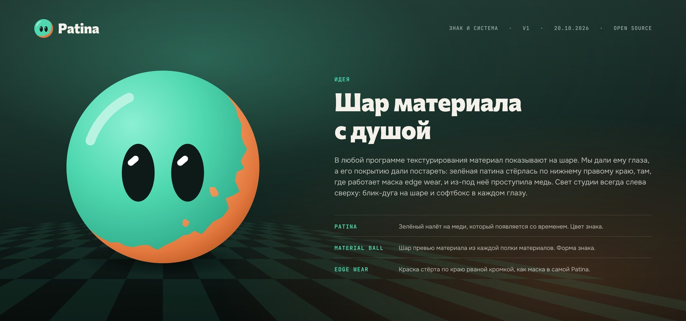

# Patina brand

The sign is the material ball, the sphere every texturing app shows its materials on, with eyes: a material
with a soul. Its verdigris coat (the patina) is worn through on the lower right rim, where an edge-wear mask
would take it off, so the copper underneath shows in a torn edge and two loose flakes. The studio light always
comes from the top left: a gloss arc on the ball and a softbox in each eye. In motion the ball ages: a fresh
coat wears off at the edge, the flakes chip away, the ball blinks.

## Colours

| Name | Hex | Use |
| --- | --- | --- |
| Verdigris | `#4FD8B0` | The coat of the sign, the one colour people remember. |
| Copper | `#E2783E` | The metal under the coat. Only inside the sign, where the coat is worn. |
| Oxide | `#0E1A17` | Ink, text, the dark studio. |
| Paper | `#F4F1EA` | Light backgrounds for documents and the README. |
| Gloss | `#FFFFFF` | Softboxes in the eyes and highlights. |

Contrast: Verdigris on Oxide 10.0:1, Paper on Oxide 15.8:1, Copper on Oxide 5.9:1. Verdigris on Paper is 1.6:1,
so on light grounds the full-colour sign is fine (its eyes and copper carry it), but text and one-colour signs
are drawn in Oxide (`patina-sign-oxide.svg`).

## Rules

- Keep clear space around the sign and the lockups of at least one eye height (30 units on the 100-unit grid).
- Minimum size: the sign at 16 px (pixel master), the horizontal lockup at 120 px wide or 25 mm in print.
- The light comes from the top left and the wear sits on the lower right: do not mirror or rotate the sign.
- Do not stretch, outline or recolour the sign beyond the files here. The eyes always look at the viewer.
- The wordmark is set in Commissioner with flared terminals (FLAR 100, VOLM 100, weight 800, tracking -12/1000 em)
  and outlined in every SVG, so no font is needed to use these files. Commissioner: Copyright 2019 The Commissioner
  Project Authors (https://github.com/kosbarts/Commissioner), SIL Open Font License 1.1.

## Files

| File | What |
| --- | --- |
| `patina-sign.svg` | The sign in colour (any background) |
| `patina-sign-verdigris.svg`, `-oxide.svg`, `-white.svg` | One-colour signs: the copper is cut free by a thin gap |
| `patina-wordmark-oxide.svg`, `-paper.svg` | The wordmark alone |
| `patina-lockup-horizontal-{light,dark,mono-oxide,mono-white}.svg` | Sign and wordmark in a row |
| `patina-lockup-stacked-{light,dark}.svg` | Sign above the wordmark |
| `icon-1024.png` (also `icon.png`), `favicon.svg` | App icon master and favicon |
| `readme-banner-{light,dark}.{png,svg}` | README banners |
| `social-preview.{png,svg}` | GitHub social preview (1280×640) |
| `github-avatar.png` | Avatar |

App icons for the desktop build live in `apps/desktop/src-tauri/icons/`: the 32 and 64 px icons and the `.ico` use
the small-size masters (flat colours at 24-48 px, a pixel-drawn 16 px), the rest are generated from `icon-1024.png`
with `tauri icon`. Everything here is built from code (sign geometry on a 100-unit grid), so change the generator,
not the files.
